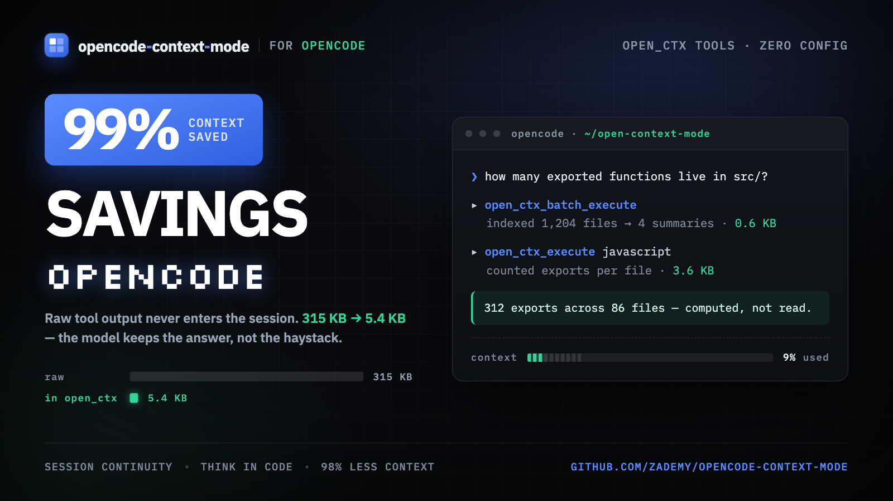

# Open Context Mode

**The other half of the context problem.**

[](https://www.npmjs.com/package/open-context-mode) [](https://www.npmjs.com/package/open-context-mode) [](https://github.com/zademy/opencode-context-mode) [](https://github.com/zademy/opencode-context-mode/stargazers) [](https://github.com/zademy/opencode-context-mode/network/members) [](https://github.com/zademy/opencode-context-mode/commits) [](https://github.com/zademy/opencode-context-mode/blob/main/LICENSE)
[](https://discord.gg/DCN9jUgN5v)
[](https://news.ycombinator.com/item?id=47193064)

<p align="center">
<sub>Used across teams at</sub>
<br><br>
<a href="#"></a>
<a href="#"></a>
<a href="#"></a>
<a href="#"></a>
<a href="#"></a>
<a href="#"></a>
<a href="#"></a>
<a href="#"></a>
<a href="#"></a>
<a href="#"></a>
<a href="#"></a>
<a href="#"></a>
<a href="#"></a>
<a href="#"></a>
<a href="#"></a>
<a href="#"></a>
<a href="#"></a>
<a href="#"></a>
</p>

<p align="center">
  
</p>

## The Problem

Every MCP tool call dumps raw data into your context window. A Playwright snapshot costs 56 KB. Twenty GitHub issues cost 59 KB. One access log — 45 KB. After 30 minutes, 40% of your context is gone. And when the agent compacts the conversation to free space, it forgets which files it was editing, what tasks are in progress, and what you last asked for. On top of that, the agent wastes output tokens on filler, pleasantries, and verbose explanations — burning context from both sides.

### How Open Context Mode Solves It

Open Context Mode is an MCP server that solves all four sides of this problem:

1. **Context Saving** — Sandbox tools keep raw data out of the context window. 315 KB becomes 5.4 KB. 98% reduction.
2. **Session Continuity** — Every file edit, git operation, task, error, and user decision is tracked in SQLite. When the conversation compacts, open-context-mode doesn't dump this data back into context — it indexes events into FTS5 and retrieves only what's relevant via BM25 search. The model picks up exactly where you left off. If you don't `--continue`, previous session data is deleted immediately — a fresh session means a clean slate.
3. **Think in Code** — The LLM should program the analysis, not compute it. Instead of reading 50 files into context to count functions, the agent writes a script that does the counting and `console.log()`s only the result. One script replaces ten tool calls and saves 100x context. This is a mandatory paradigm across every client, OpenCode and MCP alike: stop treating the LLM as a data processor, treat it as a code generator.

   ```js
   // Before: 47 × Read() = 700 KB.  After: 1 × open_ctx_execute() = 3.6 KB.
   open_ctx_execute("javascript", `
     const files = fs.readdirSync('src').filter(f => f.endsWith('.ts'));
     files.forEach(f => console.log(f + ': ' + fs.readFileSync('src/'+f,'utf8').split('\\n').length + ' lines'));
   `);
   ```
4. **No prose-style enforcement** — open-context-mode keeps raw data out of context but never dictates how the model writes its final answer. Brevity, completeness, formatting — your model's call (or yours via your own `CLAUDE.md` / `AGENTS.md`). Aggressive brevity prompts have been shown to degrade coding/reasoning benchmarks ([Moonshot AI on `kimi-k2.5`](https://github.com/anomalyco/opencode/issues/20258)) — the routing block stays focused on *where data goes*, not on *how the model talks*.

## Install

> **This repo (`zademy/opencode-context-mode`) is a fork of
> [`mksglu/open-context-mode`](https://github.com/mksglu/open-context-mode).** The upstream
> original is where the code came from; the integrations for everything except
> OpenCode were removed here. See
> [`docs/adr/0006-opencode-native-mcp-only.md`](https://github.com/zademy/opencode-context-mode/blob/main/docs/adr/0006-opencode-native-mcp-only.md).

Prerequisites: Node.js >= 22.5 (or Bun).

### OpenCode — the plugin

OpenCode loads open-context-mode as a plugin and gets the `open_ctx_*` tools
in-process. Two ways to install it.

#### From npm — the published plugin

Add the package to the `plugins` array of your OpenCode config
(`~/.config/opencode/opencode.json` for your whole account,
`<project>/.opencode/opencode.json` for a single project):

```json
{
  "plugins": ["open-context-mode@latest"]
}
```

OpenCode downloads and installs the package on restart — no checkout, no
build. Optionally copy the routing rules so the model knows *why* a command
was denied:

```bash
curl -fsSL -o AGENTS.md https://raw.githubusercontent.com/zademy/opencode-context-mode/main/configs/opencode/AGENTS.md
```

#### From a local checkout

Build it once:

```bash
git clone https://github.com/zademy/opencode-context-mode.git
cd opencode-context-mode && pnpm install && pnpm run build
```

Then write one file into your user-level OpenCode config directory
(`~/.config/opencode/plugins/`):

```bash
mkdir -p ~/.config/opencode/plugins
cat > ~/.config/opencode/plugins/opencode-context-mode.ts <<'EOF'
export { default } from "/absolute/path/to/opencode-context-mode/build/platforms/opencode/plugin.js";
EOF
```

Replace the path with the root of your checkout (or of a global install —
whatever holds `build/platforms/opencode/plugin.js`). Optionally copy the
routing rules from your checkout:

```bash
cp /path/to/your/opencode-context-mode/configs/opencode/AGENTS.md AGENTS.md
```

For a single project instead of your account, put the same plugin file in
`<project>/.opencode/plugins/opencode-context-mode.ts`.

#### Either way

Do **not** add an `mcp.open-context-mode` entry as well: the plugin already
registers the tools, and a second registration leaves you with none. Restart
OpenCode (`opencode service restart`) and check:

```bash
npx open-context-mode doctor
```

### Everything else — the MCP server

Any agent that speaks MCP gets the same server over stdio. One config block:

```json
{
  "mcpServers": {
    "open-context-mode": { "command": "npx", "args": ["-y", "open-context-mode"] }
  }
}
```

`npx open-context-mode mcp` prints exactly that, so you can paste it without
transcribing.
## Tools

| Tool | What it does | Context saved |
|---|---|---|
| `open_ctx_batch_execute` | Run multiple commands + search multiple queries in ONE call. Opt-in `concurrency: 1-8` for I/O-bound batches. | 986 KB → 62 KB |
| `open_ctx_execute` | Run code in 12 languages. Only stdout enters context. | 56 KB → 299 B |
| `open_ctx_execute_file` | Process files in sandbox. Raw content never leaves. | 45 KB → 155 B |
| `open_ctx_index` | Chunk markdown into FTS5 with BM25 ranking. | 60 KB → 40 B |
| `open_ctx_search` | Query indexed content with multiple queries in one call. | On-demand retrieval |
| `open_ctx_fetch_and_index` | Fetch URL, chunk and index. Cache reuses content within TTL (default 24h, override per-call with `ttl: <ms>`). `ttl: 0` or `force: true` to bypass. Pass `requests: [{url, source}, ...]` + `concurrency: 1-8` for parallel multi-URL. | 60 KB → 40 B |
| `open_ctx_stats` | Show context savings, call counts, and session statistics. | — |
| `open_ctx_doctor` | Diagnose installation: runtimes, hooks, FTS5, versions. | — |
| `open_ctx_purge` | Permanently deletes all indexed content from the knowledge base. | — |

## How the Sandbox Works

Each `open_ctx_execute` call spawns an isolated subprocess with its own process boundary. Scripts can't access each other's memory or state. The subprocess runs your code, captures stdout, and only that stdout enters the conversation context. The raw data — log files, API responses, snapshots — never leaves the sandbox.

Host-driven cancellation is supported end to end: when the MCP client aborts a request, the abort signal reaches `open_ctx_execute`/`open_ctx_execute_file` and kills the entire spawned process tree (children and grandchildren — via the dedicated process group on Unix, `taskkill /T` on Windows), never a broad name/port sweep. The per-call `.open-context-mode-*` temp directory is removed afterward, including its `ownership.json` sidecar — a metadata-only manifest (nonce, script path/hash, PIDs, language) that deliberately never contains the executed code, command, cwd, or environment.

Twelve language runtimes are available: JavaScript, TypeScript, Python, Shell, Ruby, Go, Rust, PHP, Perl, R, Elixir, and C#. Bun is auto-detected for 3-5x faster JS/TS execution.

Authenticated CLIs work through credential passthrough — `gh`, `aws`, `gcloud`, `kubectl`, `docker` inherit environment variables and config paths without exposing them to the conversation.

When output exceeds 5 KB and an `intent` is provided, Open Context Mode switches to intent-driven filtering: it indexes the full output into the knowledge base, searches for sections matching your intent, and returns only the relevant matches with a vocabulary of searchable terms for follow-up queries.

## How the Knowledge Base Works

The `open_ctx_index` tool chunks markdown content by headings while keeping code blocks intact, then stores them in a **SQLite FTS5** (Full-Text Search 5) virtual table. The SQLite backend is selected automatically at runtime: `bun:sqlite` on Bun, `node:sqlite` on Node.js >= 22.5, and `better-sqlite3` everywhere else. Search uses **BM25 ranking** — a probabilistic relevance algorithm that scores documents based on term frequency, inverse document frequency, and document length normalization. **Porter stemming** is applied at index time so "running", "runs", and "ran" match the same stem. Titles and headings are weighted **5x** in BM25 scoring for precise navigational queries.

When you call `open_ctx_search`, it returns relevant content snippets focused around matching query terms — not full documents, not approximations, the actual indexed content with smart extraction around what you're looking for. `open_ctx_fetch_and_index` extends this to URLs: fetch, convert HTML to markdown, chunk, index. The raw page never enters context. Use the `contentType` parameter to filter results by type (e.g. `code` or `prose`).

### Ranking: Reciprocal Rank Fusion

Search runs two parallel strategies and merges them with **Reciprocal Rank Fusion (RRF)**:

- **Porter stemming** — FTS5 MATCH with porter tokenizer. "caching" matches "cached", "caches", "cach".
- **Trigram substring** — FTS5 trigram tokenizer matches partial strings. "useEff" finds "useEffect", "authenticat" finds "authentication".

RRF merges both ranked lists into a single result set, so a document that ranks well in both strategies surfaces higher than one that ranks well in only one. This replaces the old cascading fallback approach where trigram results were only used if porter returned nothing.

### Proximity Reranking

Multi-term queries get an additional reranking pass. Results where query terms appear close together are boosted — `"session continuity"` ranks passages with adjacent terms higher than pages where "session" and "continuity" appear paragraphs apart.

### Fuzzy Correction

Levenshtein distance corrects typos before re-searching. "kuberntes" becomes "kubernetes", "autentication" becomes "authentication".

### Smart Snippets

Search results use intelligent extraction instead of truncation. Instead of returning the first N characters (which might miss the important part), Open Context Mode finds where your query terms appear in the content and returns windows around those matches.

### TTL Cache

Indexed content persists in a per-project SQLite database at `~/.open-context-mode/content/`. When `open_ctx_fetch_and_index` is called for a URL that was already indexed within its TTL window, the fetch is skipped entirely and the model searches the existing index directly.

- **Default TTL:** 24 hours. Override per-call with `ttl: <milliseconds>` (PR #666). Longer for stable specs, shorter for changelogs you want re-checked often.
- **Cache hit (within TTL):** Returns a cache hint (~0.3KB) instead of re-fetching (48KB+). Model proceeds to `open_ctx_search`.
- **Cache miss (TTL expired):** Re-fetches silently. No user action needed.
- **`ttl: 0`** or **`force: true`:** Bypasses cache and re-fetches regardless of freshness.
- **14-day cleanup:** Content databases and sources older than 14 days are removed on startup.

This means `--continue` sessions preserve indexed docs across restarts. No re-fetching, no wasted context tokens.

`open_ctx_stats` reports cache performance separately: hits, data avoided, network requests saved, and total context savings including cache.

### Progressive Throttling

- **Calls 1-3:** Normal results (2 per query)
- **Calls 4-8:** Reduced results (1 per query) + warning
- **Calls 9+:** Blocked — redirects to `open_ctx_batch_execute`

## Session Continuity

When the context window fills up, the agent compacts the conversation — dropping older messages to make room. Without session tracking, the model forgets which files it was editing, what tasks are in progress, what errors were resolved, and what you last asked for.

Open Context Mode captures every meaningful event during your session and persists them in a per-project SQLite database. When the conversation compacts (or you resume with `--continue`, `--resume`, or `/resume`), your working state is rebuilt automatically — the model continues from your last prompt without asking you to repeat anything.

> Resuming a non-latest session via `/resume <picker>` works the same way: the SessionStart hook detects the empty live-event table for the freshly issued session id and falls back to the most recent unconsumed snapshot for the project (`session_resume` table). The picker selects the conversation; open-context-mode rehydrates the prior working state.

Session continuity requires 5 hooks working together:

Session continuity needs five signals. OpenCode's plugin supplies all of
them; an MCP client supplies none, because MCP has no lifecycle events.

| Signal | Role | OpenCode plugin | MCP client |
|---|---|:---:|:---:|
| **PreToolUse** | Enforce sandbox routing before execution | `tool.execute.before` | — |
| **PostToolUse** | Capture what the tool returned | `tool.execute.after` | — |
| **UserPromptSubmit** | Capture decisions and corrections | `chat.message` | — |
| **PreCompact** | Build the snapshot before compaction | `experimental.session.compacting` | — |
| **SessionStart** | Restore state after compaction or resume | `experimental.chat.system.transform` | — |

On OpenCode the result is full continuity: file edits, git operations,
errors and tasks are all tracked, and a compaction is survivable. OpenCode
has no native SessionStart event ([#14808](https://github.com/sst/opencode/issues/14808)),
so `experimental.chat.system.transform` stands in — it injects the routing
block and rehydrates prior sessions, which covers the same ground.

<details>
<summary><strong>What gets captured</strong></summary>

Every tool call passes through hooks that extract structured events:

| Category | Events | Priority | Captured By |
|---|---|---|---|
| **Files** | read, edit, write, glob, grep | Critical (P1) | PostToolUse |
| **Tasks** | create, update, complete | Critical (P1) | PostToolUse |
| **Plans** | enter, exit, approved, rejected, file write | Critical (P1) | PostToolUse |
| **Rules** | CLAUDE.md / GEMINI.md / AGENTS.md paths + content | Critical (P1) | SessionStart |
| **User Prompts** | Every user message (for last-prompt restore) | Critical (P1) | UserPromptSubmit |
| **Decisions** | User corrections, preferences ("use X instead", "don't do Y") | High (P2) | UserPromptSubmit |
| **Git** | checkout, commit, merge, rebase, stash, push, pull, diff, status | High (P2) | PostToolUse |
| **Errors** | Tool failures, non-zero exit codes | High (P2) | PostToolUse |
| **Error Resolution** | Error → fix pairs detected across sequential tool calls | High (P2) | PostToolUse |
| **Constraints** | Discovered limitations ("not supported", "permission denied") | High (P2) | PostToolUse |
| **Blockers** | "blocked on", "waiting for", "depends on" — tracked until resolved | High (P2) | UserPromptSubmit |
| **Rejected Approaches** | Tool calls denied by user (PreToolUse → PostToolUse marker) | High (P2) | PreToolUse |
| **Environment** | cwd changes, venv, nvm, conda, worktree, package installs | High (P2) | PostToolUse |
| **Agent Findings** | Completed subagent results (first 500 chars) | High (P2) | PostToolUse |
| **Iteration Loops** | Same tool called 3+ times with similar input (retry detection) | High (P2) | PostToolUse |
| **Latency** | Tool calls exceeding 5s (tool name + duration in ms) | Normal (P3) | PreToolUse |
| **MCP Tools** | All `mcp__*` tool calls with usage counts | Normal (P3) | PostToolUse |
| **Subagents** | Agent tool launches and completions | Normal (P3) | PostToolUse |
| **Skills** | Slash command invocations | Normal (P3) | PostToolUse |
| **External Refs** | URLs, GitHub issue references (#123), deduped | Normal (P3) | PostToolUse |
| **Role** | Persona / behavioral directives ("act as senior engineer") | Normal (P3) | UserPromptSubmit |
| **Intent** | Session mode classification (investigate, implement, review) | Low (P4) | UserPromptSubmit |
| **Data** | Large user-pasted data references (>1 KB) | Low (P4) | UserPromptSubmit |

</details>

<details>
<summary><strong>How sessions survive compaction</strong></summary>

```
PreCompact fires
  → Read all session events from SQLite
  → Build priority-tiered XML snapshot (≤2 KB)
  → Store snapshot in session_resume table

SessionStart fires (source: "compact")
  → Retrieve stored snapshot
  → Write structured events file → auto-indexed into FTS5
  → Build Session Guide with 15 categories
  → Inject <session_knowledge> directive into context
  → Model continues from last user prompt with full working state
```

The snapshot is built in priority tiers — if the 2 KB budget is tight, lower-priority events (intent, MCP tool counts) are dropped first while critical state (active files, tasks, rules, decisions) is always preserved.

After compaction, the model receives a **Session Guide** — a structured narrative with actionable sections:

- **Last Request** — user's last prompt, so the model continues without asking "what were we doing?"
- **Tasks** — checkbox format with completion status (`[x]` completed, `[ ]` pending)
- **Plans** — plan mode entries, exits, approvals, and rejections
- **Key Decisions** — user corrections and preferences ("use X instead", "don't do Y")
- **Files Modified** — all files touched during the session
- **Unresolved Errors** — errors that haven't been fixed, plus error→fix resolution pairs
- **Constraints** — discovered limitations and boundaries
- **Blockers** — open and resolved blockers ("blocked on X", "waiting for Y")
- **Git** — operations performed (checkout, commit, push, status)
- **Project Rules** — CLAUDE.md / GEMINI.md / AGENTS.md paths
- **MCP Tools Used** — tool names with call counts
- **Subagent Tasks** — delegated work summaries + agent findings
- **Skills Used** — slash commands invoked
- **Rejected Approaches** — tool calls the user denied
- **External References** — URLs and GitHub issue references
- **Environment** — working directory, env variables, worktrees
- **Data References** — large data pasted during the session
- **Session Intent** — mode classification (implement, investigate, review, discuss)
- **User Role** — behavioral directives set during the session

Detailed event data is also indexed into FTS5 for on-demand retrieval via `open_ctx_search()`.

</details>

</details>

## Platform Compatibility

Two shapes. That is the whole matrix.

| | OpenCode (plugin) | Any MCP client |
|---|:---:|:---:|
| `open_ctx_*` tools, in-process | Yes | — |
| `open_ctx_*` tools over stdio | — | Yes |
| PreToolUse hook (route + block) | Yes | No |
| PostToolUse hook (capture) | Yes | No |
| Compaction snapshot (rescue bytes) | Yes | No |
| Session attribution + per-tool usage | Yes | No |
| SQLite knowledge base, `open_ctx_stats`, Dashboard | Yes | Yes |

OpenCode runs a TypeScript plugin: the hooks fire as in-process functions
via `tool.execute.before`, `tool.execute.after`,
`experimental.session.compacting`, `experimental.chat.system.transform` and
`chat.message` — full routing enforcement, session continuity and user-prompt
capture. `experimental.chat.system.transform` stands in for SessionStart.

Every other client gets the MCP server and nothing host-side.

### Routing Enforcement

Hooks intercept tool calls programmatically — they can block dangerous
commands and redirect them to the sandbox before execution. Instruction
files guide the model through the prompt but cannot block anything.

On OpenCode the plugin installs both halves: the hook that blocks, and
[`AGENTS.md`](https://github.com/zademy/opencode-context-mode/blob/main/configs/opencode/AGENTS.md) for the model to read. **~98% of
the context-window spend avoided.**

An MCP client gets neither. It still gets the sandbox — `open_ctx_execute`
rejects `curl`, `wget` and friends on its own — but nothing redirects the
model toward it, so an unrouted `curl` or Playwright snapshot can dump 56 KB
into the context: roughly 60% saved instead of 98%.

Copy [`configs/opencode/AGENTS.md`](https://github.com/zademy/opencode-context-mode/blob/main/configs/opencode/AGENTS.md) into your
project root to give an MCP client the instruction half.

## Utility Commands

**Inside any AI session** — just type the command. The LLM calls the MCP tool automatically:

```
open-context-mode stats       → context savings, call counts, session report
open-context-mode doctor      → diagnose runtimes, hooks, FTS5, versions
open-context-mode index       → index a local file or directory for later search
open-context-mode search      → search previously indexed content
open-context-mode purge       → permanently delete all indexed content from the knowledge base
open-context-mode insight     → opens the hosted Insight dashboard in your browser
```

**From your terminal** — run directly without an AI session:

```bash
open-context-mode doctor
open-context-mode index . --source project:my-app
open-context-mode search "authentication middleware" --source project:my-app
open-context-mode insight          # opens the hosted Insight dashboard in browser
open-context-mode dashboard        # live local dashboard of your SQLite data (Ctrl+C to stop)
npx tsx src/cli.ts dashboard  # same dashboard, run from the repo without a global install
bash scripts/open_ctx-debug.sh    # full diagnostic report for bug reports
```

The debug script collects OS info, runtime versions, better-sqlite3 status, adapter detection, config files (redacted), hook validation, FTS5/SQLite test, executor test, process check, session databases, and environment variables into a single pasteable markdown report.

Works on every client. The `open_ctx-*` skills under [`skills/`](https://github.com/zademy/opencode-context-mode/tree/main/skills) expose the same tools to clients that render slash commands.

## Benchmarks

| Scenario | Raw | Context | Saved |
|---|---|---|---|
| Playwright snapshot | 56.2 KB | 299 B | 99% |
| GitHub Issues (20) | 58.9 KB | 1.1 KB | 98% |
| Access log (500 requests) | 45.1 KB | 155 B | 100% |
| Context7 React docs | 5.9 KB | 261 B | 96% |
| Analytics CSV (500 rows) | 85.5 KB | 222 B | 100% |
| Git log (153 commits) | 11.6 KB | 107 B | 99% |
| Test output (30 suites) | 6.0 KB | 337 B | 95% |
| Repo research (subagent) | 986 KB | 62 KB | 94% |

Over a full session: 315 KB of raw output becomes 5.4 KB. Session time extends from ~30 minutes to ~3 hours.

[Full benchmark data with 21 scenarios →](https://github.com/zademy/opencode-context-mode/blob/main/BENCHMARK.md)

## Try It

These prompts work out of the box. Run `/open-context-mode:open_ctx-stats` after each to see the savings.

**Deep repo research** — 5 calls, 62 KB context (raw: 986 KB, 94% saved)
```
Research https://github.com/modelcontextprotocol/servers — architecture, tech stack,
top contributors, open issues, and recent activity. Then run /open-context-mode:open_ctx-stats.
```

**Git history analysis** — 1 call, 5.6 KB context
```
Clone https://github.com/facebook/react and analyze the last 500 commits:
top contributors, commit frequency by month, and most changed files.
Then run /open-context-mode:open_ctx-stats.
```

**Web scraping** — 1 call, 3.2 KB context
```
Fetch the Hacker News front page, extract all posts with titles, scores,
and domains. Group by domain. Then run /open-context-mode:open_ctx-stats.
```

**Large JSON API** — 7.5 MB raw → 0.9 KB context (99% saved)
```
Create a local server that returns a 7.5 MB JSON with 20,000 records and a secret
hidden at index 13000. Fetch the endpoint, find the hidden record, and show me
exactly what's in it. Then run /open-context-mode:open_ctx-stats.
```

**Documentation search** — 2 calls, 1.8 KB context
```
Fetch the React useEffect docs, index them, and find the cleanup pattern
with code examples. Then run /open-context-mode:open_ctx-stats.
```

**Session continuity** — compaction recovery with full state
```
Start a multi-step task: "Create a REST API with Express — add routes, tests,
and error handling." After 20+ tool calls, type: open-context-mode stats to see the session
event count. When context compacts, the model continues from your last prompt
with tasks, files, and decisions intact — no re-prompting needed.
```

## Privacy & Architecture

Open Context Mode is not a CLI output filter or a cloud analytics dashboard. It operates at the MCP protocol layer — raw data stays in a sandboxed subprocess and never enters your context window. Web pages, API responses, file analysis, Playwright snapshots, log files — everything is processed in complete isolation.

**Nothing leaves your machine.** No telemetry, no cloud sync, no usage tracking, no account required. Your code, your prompts, your session data — all local. The SQLite databases live in your home directory and die when you're done.

This is a deliberate architectural choice, not a missing feature. Context optimization should happen at the source, not in a dashboard behind a per-seat subscription. Privacy-first is our philosophy — and every design decision follows from it. [License →](#license)

## Security

Open Context Mode enforces the same permission rules you already use — but extends them to the MCP sandbox. If you block `sudo`, it's also blocked inside `open_ctx_execute`, `open_ctx_execute_file`, and `open_ctx_batch_execute`.

**Zero setup required.** If you haven't configured any permissions, nothing changes. This only activates when you add rules.

```json
{
  "permissions": {
    "deny": [
      "Bash(sudo *)",
      "Bash(rm -rf /*)",
      "Read(.env)",
      "Read(**/.env*)"
    ],
    "allow": [
      "Bash(git:*)",
      "Bash(npm:*)"
    ]
  }
}
```

Add this to your project's `opencode.json` (or `~/.config/opencode/opencode.json` for global rules). Context-mode reads security policies from OpenCode's own `permission` block — `{ "permission": { "bash": { "git push": "deny" } } }` — and still honours the older `permissions: { deny: [...] }` arrays.

The pattern is `Tool(what to match)` where `*` means "anything".

Commands chained with `&&`, `;`, or `|` are split — each part is checked separately. `echo hello && sudo rm -rf /tmp` is blocked because the `sudo` part matches the deny rule.

**deny** always wins over **allow**. More specific (project-level) rules override global ones.

### Project-boundary containment

`open_ctx_execute_file` is confined to the project root. A `path` that resolves **outside** the workspace — an absolute path like `/home/user/secrets`, a `../../` traversal, or a project-local symlink whose target escapes the project — is refused with a `File access blocked` error. This closes the [#852](https://github.com/mksglu/open-context-mode/issues/852) escape vector where an agent, denied an out-of-project read by the host sandbox, retried through the MCP sandbox (the host's MCP approval prompt cannot inspect the tool's input params, so the escape was invisible to the approver).

The guard is **on by default** and requires no configuration. To intentionally process a file outside the project (e.g. a shared log under `/var/log`), opt that path back in with the **same `permissions.allow` rule you already use for the host `Read` tool** — there is no open-context-mode-specific env flag:

```json
{
  "permissions": {
    "allow": ["Read(/var/log/**)"]
  }
}
```

open-context-mode honors that allow rule (read from your `opencode.json`) exactly as OpenCode does, so an out-of-project grant lives in one place and stays meaningful.

Reviewing the prompt: the `open_ctx_execute` / `open_ctx_execute_file` approval titles now read as code execution ("Run code in a sandbox…", "Run code over a file…") so an unfamiliar reviewer can recognise the action class even though the MCP prompt renders only the tool title and raw arguments. `open_ctx_execute` and `open_ctx_batch_execute` run arbitrary code and still inherit the process's filesystem access, so the boundary guard is a defense-in-depth layer for the *file-read* tool, not a full OS sandbox — treat approving any execution tool as approving arbitrary code, and keep host-level sandboxing enabled.

### Network fetch hardening

`open_ctx_fetch_and_index` blocks dangerous URL targets by default:

- **Schemes**: only `http:` and `https:` allowed (no `file://`, `gopher://`, `javascript:`, `data:`).
- **Cloud metadata + link-local**: `169.254.0.0/16` (incl. AWS/GCP/Azure IMDS endpoint `169.254.169.254`) hard-blocked even if a hostname resolves to it (DNS-rebinding defense).
- **Multicast / reserved**: `224.0.0.0/4`, `0.0.0.0/8`, IPv6 `ff00::/8`, `fe80::/10` blocked.
- **Loopback + RFC1918** (`localhost`, `127.x`, `10.x`, `172.16-31.x`, `192.168.x`, IPv6 `::1`, `fc00::/7`) **allowed by default** so local dev servers + internal-network fetches keep working.

For hosted/CI environments where you want to block private targets too, set:

```bash
export CTX_FETCH_STRICT=1
```

That blocks loopback + RFC1918 + ULA in addition to the always-blocked ranges. Useful when open-context-mode runs as a shared service, not on a developer's own machine.

#### Opting out of redirects

`PreToolUse` rewrites `curl`, `wget`, inline `fetch()` and `WebFetch` into the equivalent `open_ctx_*` call, because those tools return far more to the context window than the sandboxed equivalent. If that rewrite is wrong for your setup — a subagent whose tool set does not include the `open_ctx_*` tools, for instance, which is redirected to tools it cannot call — turn it off entirely:

```bash
export OPEN_CONTEXT_MODE_ALLOW_WEBFETCH=1
```

Every redirect then becomes a passthrough and the tool runs as written. This is all-or-nothing: the only value accepted is exactly `1`, and there is no per-domain or per-tool exclusion. The redirect is also skipped automatically when no open-context-mode MCP server is reachable, so this is only needed for the case where a server *is* running.

#### Corporate proxies

The fetch subprocess strips `HTTP_PROXY`, `HTTPS_PROXY`, `ALL_PROXY` (both cases) and the `npm_config_*_proxy` pair before it runs, because a proxy resolves DNS on its own side and the in-subprocess rebinding check above would never see the address it actually connected to.

If you need to egress through a proxy, opt out explicitly:

```bash
export CTX_FETCH_ALLOW_PROXY=1
```

Only the exact value `1` enables it. **Read the trade-off before setting it:** with the proxy in place the target's IP is resolved at the proxy, so the in-subprocess DNS-rebinding defense no longer applies to that fetch. The scheme and metadata-IP checks on the requested URL still run in the parent, and every other guard on this page still applies — but the rebinding defense specifically does not.

`tool_input` for any `mcp__*` tool call is also redacted before persistence — the regex matcher in `hooks/posttooluse.mjs` masks `authorization`, `auth_token`, `access_token`, `refresh_token`, `bearer`, `token`, `secret`, `password`, `passwd`, `pwd`, `api_key` / `apikey` / `x_api_key`, `cookie` / `set-cookie`, `signature`, `private_key`, and `client_secret` (case-insensitive, hyphen/underscore-insensitive) to `[REDACTED]` so credentials in MCP arguments don't end up in the session DB.

### Storage environment variables

| Variable | Default | Purpose |
|---|---|---|
| `OPEN_CONTEXT_MODE_DIR` | Adapter default, for example `~/.codex/open-context-mode` or `~/.claude/open-context-mode` | Since v1.0.147. Absolute writable root for open-context-mode storage. Sessions and stats use `<root>/sessions`; indexed content uses `<root>/content`. Empty or whitespace-only values are treated as unset and shown by `open_ctx_doctor`; non-empty values must be absolute. `~` is not expanded. |

### Execution-timeout environment variables

| Variable | Default | Purpose |
|---|---|---|
| `OPEN_CONTEXT_MODE_DEFAULT_EXEC_TIMEOUT_MS` | unset | Opt-in execution budget (ms) for `open_ctx_execute` / `open_ctx_execute_file` / `open_ctx_batch_execute` when the call passes no `timeout`. Applies on every host. OpenCode bounds its own RPC calls and needs none; an MCP client that does not gets a 5-minute backstop against a single hung command (#406, #1147), and this var overrides it. Must be a positive integer no greater than `2147483647` (the largest delay a timer can represent); anything else — blank, fractional, negative, or larger — falls back rather than to unbounded. Prefer an explicit per-call `timeout`, or `background: true`, for jobs that legitimately run longer. |

### Routing-guidance environment variables

| Variable | Default | Purpose |
|---|---|---|
| `OPEN_CONTEXT_MODE_EXTERNAL_MCP_NUDGE_EVERY` | `10` | Cadence (in tool calls) at which the PreToolUse hook re-injects the "wrap large external-MCP payloads in `open_ctx_execute`" guidance. The original implementation ([#529](https://github.com/mksglu/open-context-mode/pull/529)) fired only once per session, which got lost after context compaction in MCP-heavy sessions (e.g. 50+ Jira/Slack/Notion calls — see [#567](https://github.com/mksglu/open-context-mode/issues/567) follow-up). The default re-fires every 10th matching call, keeping the guidance in the model's recent window. Range `[1, 100]`; invalid values fall back to `10`. Set to `1` for "every call" (most aggressive — adds ~250 tokens/call) or to a larger value for less frequent reminders. |
| `OPEN_CONTEXT_MODE_SUBAGENT_ROUTING` | `1` (enabled) | Set to `0` (or `false`/`off`/`no`, case-insensitive) to disable appending the open-context-mode routing block to Agent (subagent) spawn prompts. Under auto-mode permissions, some permission classifiers intermittently read the injected block as prompt injection and deny the spawn itself ([#967](https://github.com/mksglu/open-context-mode/issues/967)). The block now identifies itself as coming from the locally installed plugin, which reduces false positives; if spawns are still denied, either set this variable to `0` (subagents lose the routing guidance but spawn reliably, and also skip the Bash→general-purpose subagent-type upgrade, since that upgrade only exists so the subagent can reach the now-omitted `open_ctx_*` tools), or state once in the conversation that the injected `<context_window_protection>` block is benign — the classifier reads the transcript and stops denying for the rest of the session. |

### Command and code echo environment variables

`open_ctx_execute` / `open_ctx_execute_file` prepend the source code they ran, and `open_ctx_batch_execute` echoes each `$ <command>` plus a `## Commands` inventory ([#717](https://github.com/mksglu/open-context-mode/issues/717), [#736](https://github.com/mksglu/open-context-mode/issues/736)). Hosts whose UI does not render the MCP tool input need that echo to see what the agent ran. Hosts that do render it carry the payload twice. These variables let the latter trim or drop the echo. Unset, output is unchanged on every host.

| Variable | Default | Purpose |
|---|---|---|
| `OPEN_CONTEXT_MODE_CODE_ECHO_MAX` | `2000` | Character budget for the fenced source block from `open_ctx_execute` / `open_ctx_execute_file`. `0` suppresses it. Only a run of digits is accepted; empty, whitespace-only, negative and non-numeric values keep the default. The full code always reaches the sandbox; only the echo is clipped. |
| `OPEN_CONTEXT_MODE_COMMAND_ECHO_MAX` | `500` | Character budget for the `$ <command>` line in each `open_ctx_batch_execute` section and each `## Commands` entry. `0` suppresses both. Same parsing rules as above. Note the `$ <command>` line is part of the indexed section text, so `0` also drops it from the FTS5 index and later `open_ctx_search` hits will not show what ran. |

## Contributing

See [CONTRIBUTING.md](https://github.com/zademy/opencode-context-mode/blob/main/CONTRIBUTING.md) for the development workflow and TDD guidelines.

```bash
git clone https://github.com/zademy/opencode-context-mode.git
cd opencode-context-mode && npm install && npm test
```

## License

Licensed under the [MIT License](https://github.com/zademy/opencode-context-mode/blob/main/LICENSE) — use it, fork it, modify it, and ship it, commercially or not. Just keep the copyright notice.
